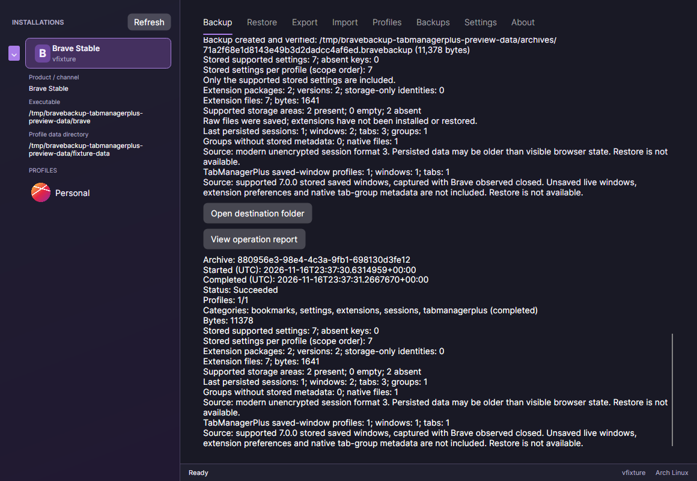

# TabManagerPlus backup and archive version 5

Implemented for review, 2026-11-17. The existing Backup category now saves validated
Tab Manager Plus 7.0.0 saved windows, alone or with Bookmarks, Settings, Extensions and
persisted Sessions. Passwords, restore/import and merge remain separate increments.

## User-visible behavior

- Choose profiles and TabManagerPlus in Backup. Every selected profile must have the
  supported official extension installation and readable saved-window collection;
  one unsupported profile blocks the whole operation instead of being omitted.
- Brave must be observed closed before capture and before publication. The app never
  closes Brave, flushes browser storage, installs a helper or writes a profile.
- Encryption stays enabled by default. An unencrypted save requires fresh confirmation
  for that destination: URLs, titles, window names and stored private-window records
  will be readable by anyone with file access. Missing confirmation or Cancel saves
  nothing. Generic raw Extensions and native-session warnings remain independent.
- Progress reports actual reading/writing/verifying/finalizing stages. Completion shows
  saved-window profile/window/tab counts and scope limits. Reports exclude browsing
  content, source paths, passwords and profile names.

This captures stored saved windows, not unsaved live windows. It preserves supported
names/colors, ordering, tab URLs/titles/pinned/active/private flags and stored geometry.
Optional absent fields remain absent. Extension preferences, transient bookkeeping,
favicon images and native Chromium tab-group metadata are outside this projection.
The independent Extensions category continues to preserve raw extension files/storage.

Only official ID `cnkdjjdmfiffagllbiiilooaoofcoeff`, researched package version 7.0.0,
manifest version 3 and matching stored version are supported. Missing/deleted collections
are unavailable; an explicit validated empty collection succeeds with zero counts.
Legacy, ambiguous, corrupt, changing or over-limit sources fail explicitly. See
[capture semantics and source research](tabmanagerplus-capture.md) and
[offline storage limits](tabmanagerplus-storage-reader.md).

## Archive contract

Archives containing this category have `formatVersion: 5` and must require
`tabmanagerplus-v1`. Their required-capability list is a canonical subset of:

```json
["bookmarks-v1", "settings-v1", "extensions-v1", "sessions-v1", "tabmanagerplus-v1"]
```

TabManagerPlus is mandatory in v5; duplicates, unknown capabilities and reordered lists
are rejected. Every profile contains each required category exactly once. Existing
category layouts stay unchanged. Without TabManagerPlus, writes retain the existing
v1/v2/v3/v4 selection rules; previous fixtures/readers remain supported by this application.
Older application versions reject v5 as unsupported; no claim of forward compatibility
is made. Encryption envelope and standalone bookmark HTML/JSON formats did not change.

The category has ID `tabmanagerplus`, version 1, and exactly one descriptor:

```text
installations/<installation-guid>/profiles/<profile-guid>/tabmanagerplus/saved-windows-v1.json
role: portable-extension-windows
```

Length is 1 byte through 32 MiB and SHA256 is lowercase hexadecimal, checked before payload parsing.
Undeclared entries, duplicate descriptors, wrong roles/paths, invalid lengths/hashes and
category/capability mismatches fail. The JSON envelope is:

```json
{
  "schemaVersion": 1,
  "captureKind": "extension-saved-windows",
  "capturedUtc": "2026-11-17T00:00:00+00:00",
  "extensionId": "cnkdjjdmfiffagllbiiilooaoofcoeff",
  "extensionVersion": "7.0.0",
  "source": "local-extension-settings",
  "sourceFileCount": 5,
  "windows": []
}
```

The example intentionally represents zero windows. A nonempty `windows` array contains
the approved source-shaped records described in the capture document, with stored
geometry under `windowsInfo` and ordered tabs under `tabs`. Serialization emits only
approved fields, omits absent nullable metadata and keeps canonical window order.
This application payload is not advertised as the extension's own import/export file.
Source-file count and capture time are informational observed provenance; the payload
does not embed the original database or independently prove its origin.

## Components and validation

- **Core:** `ExtensionSavedWindowsArchiveFormat.ValidateCategory` checks container
  linkage/hash/length and the generic saved-window envelope. `ValidatePayload` validates
  header/provenance shape, unique window IDs and aggregate collection bounds. No Brave
  source reader, OS API or dependency on the extension project is added to Core.
- **Extensions/TabManagerPlus:** `SavedWindowPayload.Serialize` bounds output and validates
  its projection. `Parse` checks exact supported identity/version/provenance, rebuilds the
  stored map for the tested typed parser, checks every field and canonical ordering,
  rejects duplicate JSON properties and honors cancellation. Models are defined in
  `SavedWindows.cs`; no package dependency is added.
- **Backup:** `BraveTabManagerPlusBackup.ValidateCategory` applies extension semantics after
  Core integrity checks. The existing `BraveSettingsBackup.ValidateArchive` entry point
  invokes this policy for v5 as well as the existing category policies. Its historical
  name remains source compatible; callers requiring full Brave validation should use it.
- **Writer:** a new `CreateAsync` overload takes `TabManagerPlusBackupOptions`, containing
  `ObserveBrowserState` and `ConfirmUnencryptedData`. Previous overloads remain available;
  defaults use real host process observation and deny unconfirmed unencrypted saved-window
  writes. UI supplies its host callbacks and clears them on disposal.

The internal capture session retains source validation metadata until publication and
disposes it on success/failure. It limits the operation to 100,000 saved windows,
100,000 tabs, 100,000 captured source files and 256 MiB of portable saved-window payloads,
in addition to per-profile parser/capture limits and archive-wide entry/size limits.
Bounded serialization rejects oversized escaped output rather than changing content.
These separate memory budgets are not a single process-memory cap.

Output uses the established private sibling temporary file, streaming encryption,
reopen/authentication/container and semantic verification, destination fingerprint check
and atomic replacement workflow. Immediately before publication, every captured profile's
shape/stamps/hashes and the stopped-browser observation are checked again. Failure or
cancellation preserves an existing destination and removes temporary output, subject to
the already documented explicit cleanup-failure reporting. No plaintext database staging
is introduced. Observations cannot eliminate races after the final check.

Unencrypted ZIP hashes detect accidental corruption, not attacker tampering. Encryption
retains the existing authentication guarantees and pending independent crypto-review
limitation; this increment does not change that protocol.

## Evidence and limits

**557 solution tests passed** on Linux: 490 Core, 48 Brave, 13 Linux and 6 Windows-labelled.
Full UI/CLI solution build succeeds with zero warnings/errors. New tests cover:

- encrypted/plain and all four compression choices with mixed categories;
- saved-windows-only capture without unrelated source files;
- fresh unencrypted consent, missing/declined callbacks and immutable UI requests;
- cancellation, changed sources and late browser starts without publication;
- unsupported profiles, partial-output cleanup and preservation of existing destinations;
- independent Python-produced v5 ZIP compatibility and rehashed semantic corruption;
- exact capability/version/descriptor rules, generic versus extension-specific validation,
  empty/nonempty payloads and truthful UI counts.

The frozen fixture and independent producer live at
`tests/Core.Tests/Fixtures/TabManagerPlus/Archive.v5.tabmanagerplus.bravebackup` and
`generate-archive-v5.py`. Old v1–4 fixtures remain unchanged. C++ LevelDB storage fixtures
and official-package evidence remain separate from this application-owned ZIP fixture.

A real Avalonia Linux software-rendered smoke run used synthetic profiles: checkbox and
Create Backup button produced an authenticated v5 archive containing all supported
categories; stored sources stayed unchanged. The actual saved-window warning displayed
the full destination and readable/private-data risk; Cancel published nothing. Existing
Extensions/native-session dialog Cancel behavior also passed. The screenshot below is
synthetic UI evidence, not a user's real Brave data:



Native Windows and real installed-Brave end-to-end validation, broader multi-table
LevelDB compatibility fixtures and independent encryption-protocol review remain release
validation work. Unsupported database layouts continue to fail explicitly.
